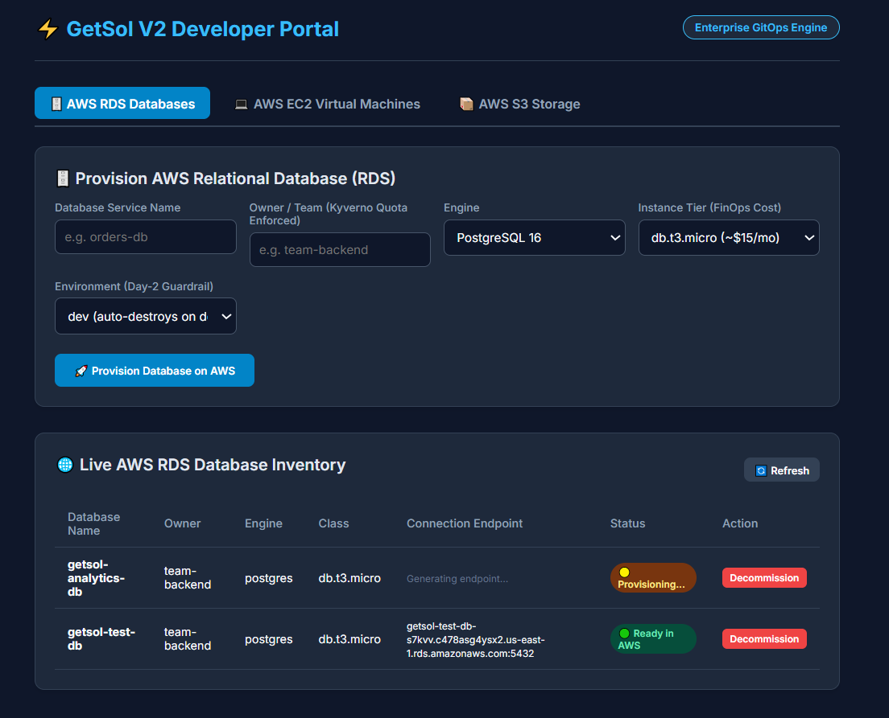
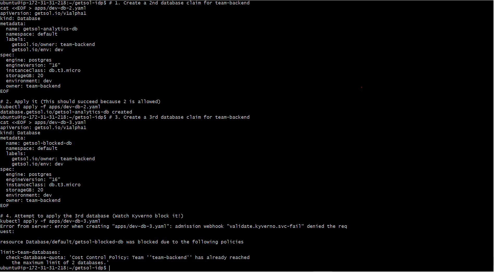
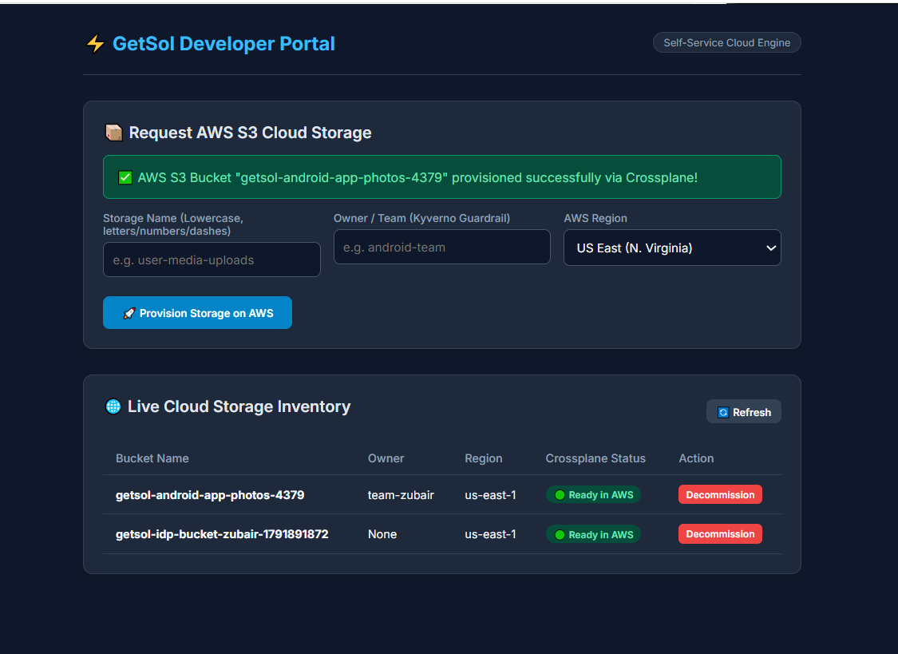
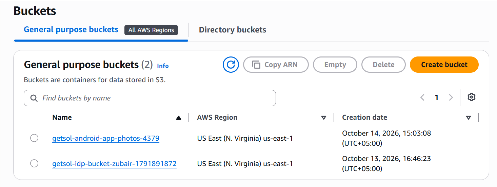
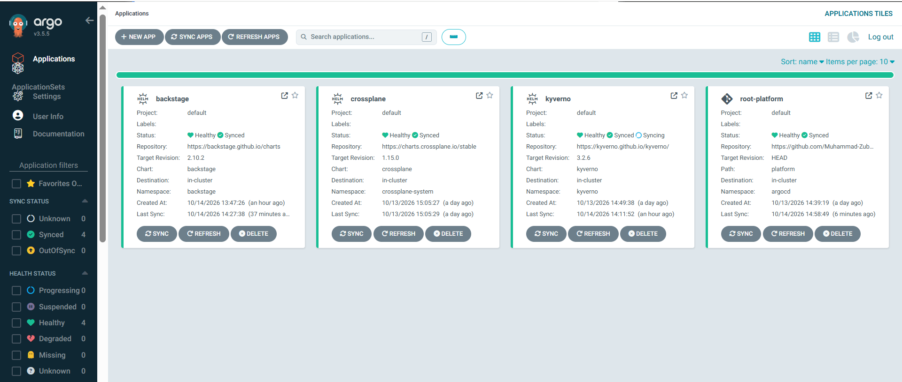
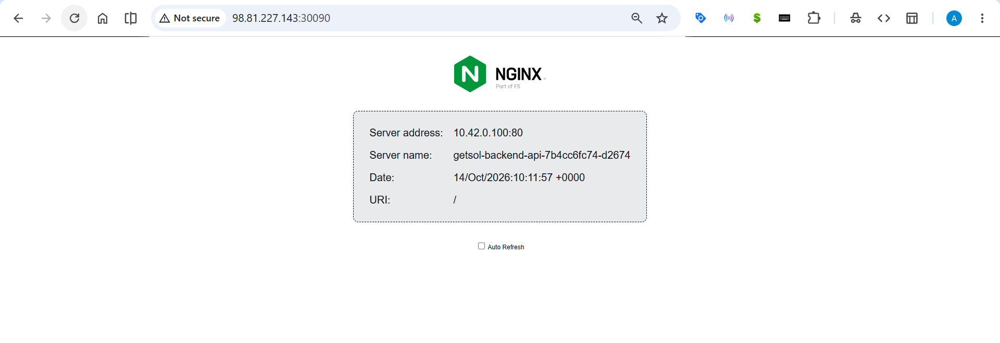

# GetSol V2 Internal Developer Platform (IDP)

An enterprise-grade, GitOps-driven **Internal Developer Platform (IDP)** designed to eliminate developer ticket friction, enforce shift-left security governance, and provide zero-YAML self-service cloud infrastructure provisioning across **AWS RDS (PostgreSQL/MySQL)**, **AWS EC2 Compute**, and **AWS S3 Storage**.

📖 **Read the Full Engineering Case Study:** [mzubair.online/projects/getsol-idp](https://www.mzubair.online/projects/getsol-idp)

---

## 📑 Table of Contents

- [Executive Summary](#-executive-summary)
- [System Architecture](#-system-architecture)
- [Platform Pillars & Core Capabilities](#-platform-pillars--core-capabilities)
- [Visual Tour & Production Proof](#-visual-tour--production-proof)
- [Repository Structure](#-repository-structure)
- [Deployment & Replication Guide](#-deployment--replication-guide)
- [Security, FinOps & Policy-as-Code](#-security-finops--policy-as-code)
- [Day-2 Operations & Automated Lifecycle Management](#-day-2-operations--automated-lifecycle-management)
- [Tech Stack](#-tech-stack)
- [Author & Maintainer](#-author--maintainer)

---

## 🚀 Executive Summary

Modern engineering teams often face severe developer bottlenecks:
1. **Infrastructure Tickets & Cloud Complexity:** Developers wait days for operations teams to provision cloud databases, compute nodes, and storage, or are forced to write hundreds of lines of complex Terraform and AWS manifests.
2. **Runaway Cloud Costs (FinOps Blindspot):** Ephemeral test databases and oversized instances are spun up and left running indefinitely with zero team-level quota enforcement or lifecycle management.
3. **Disaster Risk & Security Drift:** Lacking centralized guardrails, a developer deleting a test resource can accidentally decommission production state, or deploy un-tagged infrastructure without clear ownership.

The **GetSol V2 IDP** solves this through a unified control plane built on **Kubernetes (K3s)**. By uniting **GetSol V2 Zero-YAML Self-Service Portal**, **Spotify Backstage Software Catalog**, **Argo CD**, **Crossplane Compositions (XRDs)**, and **Kyverno Policy-as-Code**, developers can provision production-ready cloud resources with dropdowns and button clicks. The platform abstracts away raw cloud complexity, enforces automated cost quotas before requests hit AWS, and guarantees production safety through environment-driven deletion guardrails.

---

## 🏛 System Architecture

The platform establishes an end-to-end, closed-loop GitOps reconciliation engine between developer intent, policy admission controls, and live cloud providers:

<pre><code>
                                  [ Developer ]
                                        │
                    ┌───────────────────┴───────────────────┐
                    │ Interacts via Web UI (Zero YAML)      │
                    ▼                                       ▼
       ┌─────────────────────────────┐         ┌─────────────────────────────┐
       │  GetSol V2 Developer Portal │         │   Spotify Backstage Catalog │
       │  (Port 30080)               │         │   (Port 30070)              │
       │  - Dropdowns: RDS, EC2, S3  │         │   - Service & System Graph  │
       │  - FinOps Cost Estimation   │         │   - Microservice Inventory  │
       │  - Day-2 Decommissioning    │         │   - Cloud Dependency Map    │
       └──────────────┬──────────────┘         └──────────────┬──────────────┘
                      │                                       │
                      ▼ (Submits Declarative Intent)          │
       ┌──────────────────────────────────────────────────────┴──────────────┐
       │                       KUBERNETES CONTROL PLANE                      │
       │                                                                     │
       │  ┌───────────────────────────────────────────────────────────────┐  │
       │  │ 🛡️  KYVERNO ADMISSION CONTROLLER (Policy-as-Code)            │  │
       │  │     - Enforces mandatory ownership metadata labels            │  │
       │  │     - Evaluates FinOps Team Quotas (Blocks > 2 DBs per team)  │  │
       │  │     - Scoped strictly to CREATE (unblocks controller updates) │  │
       │  └───────────────────────────────┬───────────────────────────────┘  │
       │                                  │ Approved                          │
       │                                  ▼                                  │
       │  ┌───────────────────────────────────────────────────────────────┐  │
       │  │ 🔄  ARGO CD GITOPS ENGINE (App-of-Apps Pattern)               │  │
       │  │     - Continuously reconciles cluster state against Git       │  │
       │  │     - Watches 'platform/' definitions and 'apps/' workloads   │  │
       │  │     - Automated self-healing and drift mitigation             │  │
       │  └───────────────────────────────┬───────────────────────────────┘  │
       │                                  │ Synchronized                     │
       │                                  ▼                                  │
       │  ┌───────────────────────────────────────────────────────────────┐  │
       │  │ ☁️   CROSSPLANE COMPOSITIONS & XRDS                            │  │
       │  │     - Custom APIs: xdatabases.getsol.io, xvms.getsol.io       │  │
       │  │     - Bundles Security Groups, Subnets, and Storage           │  │
       │  │     - Day-2 Deletion Guardrails: dev -> Delete, prod -> Orphan│  │
       │  └───────────────────────────────┬───────────────────────────────┘  │
       │                                  │                                  │
       │  ┌───────────────────────────────┴───────────────────────────────┐  │
       │  │ 📦  DEVELOPER WORKLOAD RUNTIME                                │  │
       │  │     - getsol-backend-service (2 Replicas, NodePort 30090)     │  │
       │  │     - Automatically wired to provisioned AWS RDS endpoints    │  │
       │  └───────────────────────────────────────────────────────────────┘  │
       └──────────────────────────────────┬──────────────────────────────────┘
                                          │ AWS API (us-east-1)
                                          ▼
       ┌─────────────────────────────────────────────────────────────────────┐
       │                        AMAZON WEB SERVICES (AWS)                    │
       │                                                                     │
       │   🗄️ AWS RDS Databases:                                             │
       │      - PostgreSQL 16 (Provisioned on demand via Composite Claim)    │
       │   💻 AWS EC2 Compute:                                               │
       │      - Ubuntu 22.04 LTS Instances (t3.micro / t3.small / t3.medium) │
       │   🪣 AWS S3 Object Storage:                                         │
       │      - On-demand encrypted multi-region storage buckets             │
       └─────────────────────────────────────────────────────────────────────┘
</code></pre>

---

## ⚡ Platform Pillars & Core Capabilities

### 1. Zero-YAML Multi-Resource Developer Portal (`:30080`)
- **Intuitive Cloud Tab Navigation:** Developers switch between **AWS RDS Databases**, **AWS EC2 Virtual Machines**, and **AWS S3 Storage** in a unified dark-mode interface.
- **FinOps Cost Transparency:** Built-in pricing guidance displays estimated monthly burn before provisioning (e.g., `db.t3.micro (~$15/mo)` vs `db.t3.medium (~$60/mo)`).
- **Day-2 Self-Service Decommissioning:** Developers can decommission their own test databases, VMs, or buckets with a single button click, instantly calling Crossplane to destroy cloud resources.

### 2. Cloud Abstraction via Crossplane Compositions (XRDs)
- **Declarative Custom APIs:** Defines company-standard APIs (`xdatabases.getsol.io` and `xvirtualmachines.getsol.io`).
- **Encapsulated Cloud Topology:** Developers specify 5 high-level properties (`engine`, `instanceClass`, `storageGB`, `environment`, `owner`). Crossplane automatically handles AWS networking, VPC parameter groups, master password secrets, and encryption.
- **Automated Lifecycle Guardrails:** Compositions dynamically calculate `deletionPolicy`:
  - `dev` $\rightarrow$ `deletionPolicy: Delete` (Ensures test resources clean up cleanly to save cloud costs).
  - `prod` $\rightarrow$ `deletionPolicy: Orphan` (Ensures production database data remains intact even upon accidental manifest deletion).

### 3. Policy-as-Code & Cost Control Quotas (Kyverno)
- **Automated FinOps Quota Enforcement:** A `limit-team-databases` ClusterPolicy inspects the live Kubernetes API at admission time. If any team attempts to provision more than 2 databases, Kyverno blocks the request with an actionable violation message.
- **Mandatory Ownership Attribution:** Every resource must provide verifiable team ownership labels, eliminating untagged shadow cloud infrastructure.

### 4. GitOps Closed-Loop Engine (Argo CD)
- **App-of-Apps Hierarchy:** Orchestrates the core platform components (`platform/`) and dynamic developer claims (`apps/`).
- **Drift Correction & Auto-Healing:** Continuously compares Git with cluster state, preventing manual cluster drift and keeping GitHub as the single source of truth.

### 5. Centralized Software Catalog (Spotify Backstage `:30070`)
- **Service & Resource Registry:** Catalogs microservices (`getsol-backend-service`), cloud resources (`getsol-postgres-database`), systems (`getsol-platform`), and teams (`team-backend`).
- **Dependency Graph Visualization:** Visually charts dependencies so engineers can see which application connects to which AWS database.

---

## 📸 Visual Tour & Production Proof

### 1. The GetSol V2 Multi-Resource Developer Portal
The developer-facing web application featuring tabbed zero-YAML provisioning for **AWS RDS**, **AWS EC2**, and **AWS S3** with live status indicators and real-time AWS endpoints.

### 2. Kyverno FinOps Team Quota Policy Blocking Excess Database
Real-time demonstration of Kyverno evaluating team quotas. When `team-backend` attempts to provision a 3rd database, the admission webhook intercepts and blocks the request with a custom cost control message.

### 3. Spotify Backstage Developer Portal & Dependency Mapping
The Spotify Backstage software catalog showing the `getsol-backend-service` component and its dependency relationship with the provisioned `Production PostgreSQL 16 Database`.

### 4. Live AWS Management Console Verification
Verification showing live cloud infrastructure provisioned in AWS `us-east-1` directly triggered by the platform's control plane.

### 5. Argo CD GitOps Dashboard
The Argo CD control plane maintaining 100% synchronization and healthy states across all platform modules (`backstage`, `crossplane`, `kyverno`, and `getsol-workloads`).

### 6. Live Containerized Backend Microservice
The live microservice running in high availability across multiple replicas, connected to the provisioned AWS RDS database.

---

## 📂 Repository Structure

<pre><code>
getsol-idp/
├── apps/                                      # GitOps developer workloads & claims
│   └── dev-db.yaml                           # PostgreSQL 16 database claim
├── catalog-info.yaml                          # Spotify Backstage catalog entities & graph
├── platform/
│   ├── root-app.yaml                          # ArgoCD Root Application (App-of-Apps)
│   ├── apps-app.yaml                          # ArgoCD Workloads Application (watches apps/)
│   ├── backstage.yaml                         # Spotify Backstage portal deployment
│   ├── portal.yaml                            # GetSol V2 Self-Service Web Portal (App, SA, RBAC)
│   ├── crossplane.yaml                        # Crossplane Core Engine deployment
│   ├── kyverno.yaml                           # Kyverno Helm deployment
│   ├── provider-aws.yaml                      # Upbound AWS Providers (S3, RDS, EC2 v1.16.0)
│   ├── provider-config.yaml                   # AWS Provider IAM credential linkage
│   ├── policy-require-owner.yaml              # Kyverno mandatory owner label policy
│   ├── policy-database-quota.yaml             # Kyverno FinOps team quota policy
│   ├── s3-storage.yaml                        # Baseline raw storage declaration
│   ├── developer-app.yaml                     # Sample developer backend microservice
│   └── compositions/                          # Enterprise Crossplane Blueprints
│       ├── database-xrd.yaml                  # Custom Database API schema (xdatabases.getsol.io)
│       ├── database-composition.yaml          # RDS PostgreSQL/MySQL implementation blueprint
│       ├── ec2-xrd.yaml                       # Custom Compute API schema (xvirtualmachines.getsol.io)
│       └── ec2-composition.yaml               # EC2 Virtual Machine implementation blueprint
├── templates/golden-path-service/             # Backstage Golden Path templates
│   ├── template.yaml                          # Self-service UI form definition
│   └── skeleton/
│       └── claim.yaml                         # Stamped out GitOps claim manifest
└── README.md                                  # Platform documentation
</code></pre>

---

## 🛠 Deployment & Replication Guide

### Prerequisites
- An AWS EC2 instance (Ubuntu 22.04 LTS, recommended: `t3.large` or larger with 40 GiB `gp3` disk).
- AWS Inbound Security Group allowing ports:
  - `22` (SSH)
  - `30070` (Spotify Backstage Catalog)
  - `30080` (GetSol V2 Developer Portal)
  - `30472` (Argo CD Dashboard)
  - `30090` (Developer Microservice API)
- An AWS IAM user with `AmazonRDSFullAccess`, `AmazonEC2FullAccess`, and `AmazonS3FullAccess` permissions.

### 1. Initialize the Kubernetes Runtime (K3s) & Network MTU
Run on your EC2 instance:
<pre><code># 1. Update and install base packages
sudo apt update && sudo apt install -y git curl wget

# 2. Set MTU to 1500 to prevent public internet packet drops on large bundles
sudo ip link set dev eth0 mtu 1500
sudo iptables -t mangle -A POSTROUTING -p tcp --tcp-flags SYN,RST SYN -j TCPMSS --clamp-mss-to-pmtu

# 3. Install lightweight Kubernetes (K3s)
curl -sfL https://get.k3s.io | sh -

# 4. Configure kubeconfig permissions
mkdir -p ~/.kube
sudo cp /etc/rancher/k3s/k3s.yaml ~/.kube/config
sudo chown $(id -u):$(id -g) ~/.kube/config
export KUBECONFIG=~/.kube/config
echo 'export KUBECONFIG=~/.kube/config' >> ~/.bashrc

# 5. Install Helm package manager
curl https://raw.githubusercontent.com/helm/helm/main/scripts/get-helm-3 | bash
</code></pre>

### 2. Install Argo CD (GitOps Engine)
<pre><code>kubectl create namespace argocd
kubectl apply -n argocd -f https://raw.githubusercontent.com/argoproj/argo-cd/stable/manifests/install.yaml
kubectl patch svc argocd-server -n argocd -p '{"spec": {"type": "NodePort", "ports": [{"port": 443, "nodePort": 30472}]}}'
kubectl wait --for=condition=available deployment/argocd-server -n argocd --timeout=300s
</code></pre>

Retrieve initial Argo CD admin password:
<pre><code>kubectl -n argocd get secret argocd-initial-admin-secret -o jsonpath="{.data.password}" | base64 -d; echo
</code></pre>

### 3. Clone Repository & Inject AWS IAM Credentials
<pre><code>cd ~
git clone https://github.com/Muhammad-Zubair796/getsol-idp.git
cd getsol-idp

# Create crossplane-system namespace
kubectl create namespace crossplane-system

# Inject AWS credentials secret
cat <<EOF > aws-creds.ini
[default]
aws_access_key_id = <YOUR_AWS_ACCESS_KEY_ID>
aws_secret_access_key = <YOUR_AWS_SECRET_ACCESS_KEY>
EOF

kubectl create secret generic aws-creds -n crossplane-system --from-file=creds=./aws-creds.ini
rm aws-creds.ini

# Create RDS Master Password Secret
kubectl create secret generic rds-master-secret -n crossplane-system --from-literal=password="GetSolSecurePass123!"
</code></pre>

### 4. Bootstrap Core Platform via Argo CD
<pre><code>kubectl apply -f platform/root-app.yaml
kubectl apply -f platform/crossplane.yaml
kubectl apply -f platform/kyverno.yaml
kubectl apply -f platform/apps-app.yaml
</code></pre>

### 5. Deploy Crossplane Providers & Compositions
<pre><code># Apply AWS Providers (S3, RDS, EC2)
kubectl apply -f platform/provider-aws.yaml

# Wait for providers to install
kubectl wait --for=condition=Healthy provider/provider-aws-rds --timeout=300s
kubectl wait --for=condition=Healthy provider/provider-aws-s3 --timeout=300s

# Link ProviderConfig to credentials
kubectl apply -f platform/provider-config.yaml

# Apply Custom Resource Definitions (XRDs) and Compositions
kubectl apply -f platform/compositions/database-xrd.yaml
kubectl apply -f platform/compositions/database-composition.yaml
kubectl apply -f platform/compositions/ec2-xrd.yaml
kubectl apply -f platform/compositions/ec2-composition.yaml

# Apply Kyverno FinOps Quota Policy (Scoped strictly to CREATE)
kubectl apply -f platform/policy-database-quota.yaml

# Deploy GetSol V2 Developer Portal
kubectl apply -f platform/portal.yaml
</code></pre>

### 6. Access Platform Endpoints
| Interface | URL | Credentials / Notes |
| :--- | :--- | :--- |
| **GetSol V2 Developer Portal** | `http://<EC2_PUBLIC_IP>:30080` | Zero-YAML Self-Service (RDS, EC2, S3) |
| **Spotify Backstage Catalog** | `http://<EC2_PUBLIC_IP>:30070/catalog` | Service directory, systems, & dependency graph |
| **Argo CD Dashboard** | `https://<EC2_PUBLIC_IP>:30472` | User: `admin`, Password from Step 2 |
| **Developer Backend API** | `http://<EC2_PUBLIC_IP>:30090` | Containerized microservice runtime |

---

## 🔒 Security, FinOps & Policy-as-Code

GetSol V2 enforces shift-left security and cost controls before requests ever reach Amazon Web Services.

### 1. FinOps Database Quota Policy (`limit-team-databases`)
Protects against runaway AWS cloud costs by restricting teams to a maximum of **2 database instances**. Notice that rules are strictly scoped to `operations: [CREATE]`, ensuring Crossplane controller `UPDATE` operations are not blocked during active reconciliation:

<pre><code>apiVersion: kyverno.io/v1
kind: ClusterPolicy
metadata:
  name: limit-team-databases
spec:
  validationFailureAction: Enforce
  background: false
  rules:
    - name: check-database-quota
      match:
        any:
          - resources:
              kinds:
                - getsol.io/v1alpha1/Database
              operations:
                - CREATE
      context:
        - name: currentCount
          apiCall:
            urlPath: "/apis/getsol.io/v1alpha1/namespaces/default/databases"
            jmesPath: "items[?metadata.labels.\"getsol.io/owner\" == '{{ request.object.metadata.labels.\"getsol.io/owner\" }}'] | length(@)"
      validate:
        message: "Cost Control Policy: Team '{{ request.object.metadata.labels.\"getsol.io/owner\" }}' has already reached the maximum limit of 2 databases."
        deny:
          conditions:
            all:
              - key: "{{ currentCount }}"
                operator: GreaterThanOrEquals
                value: 2
</code></pre>

### 2. Live Policy Verification
- **Request 1 & 2 (Within Quota):** Team `team-backend` provisions `getsol-test-db` and `getsol-analytics-db` $\rightarrow$ **Admission Approved**.
- **Request 3 (Exceeding Quota):** Team `team-backend` attempts to provision `getsol-blocked-db` $\rightarrow$ **Admission Blocked**:
<pre><code>Error from server: admission webhook "validate.kyverno.svc-fail" denied the request:
limit-team-databases:
  check-database-quota: 'Cost Control Policy: Team ''team-backend'' has already reached the maximum limit of 2 databases.'
</code></pre>

---

## 🔄 Day-2 Operations & Automated Lifecycle Management

### 1. Environment-Driven Deletion Guardrails
Crossplane Compositions evaluate `spec.environment` to configure the underlying AWS resource lifecycle automatically:

| Environment | Crossplane `deletionPolicy` | Behavior on Decommission | FinOps & Safety Impact |
| :--- | :--- | :--- | :--- |
| **`dev`** | `Delete` | Calling Decommission terminates the AWS instance immediately. | Eliminates orphaned test databases, driving cloud waste to $0. |
| **`prod`** | `Orphan` | Calling Decommission deletes the Kubernetes manifest but preserves the live AWS database. | Prevents catastrophic data loss caused by accidental human error. |

### 2. Zero-Cost Platform Parking
When not in active use, the entire platform can be paused without losing state:
1. In the **AWS EC2 Console**, choose **Instance state -> Stop instance**.
2. All compute charges drop to **$0.00**. State is preserved on the EBS volume.
3. Upon choosing **Start instance**, update the IP address in `platform/portal.yaml` and `platform/backstage.yaml`—all Crossplane bindings, GitOps state, and databases automatically resume.

---

## 🧰 Tech Stack

| Layer | Technology | Version | Purpose |
| :--- | :--- | :--- | :--- |
| **Infrastructure** | Amazon Web Services (AWS) | RDS / EC2 / S3 | Managed relational databases, virtual compute, & object storage |
| **Host OS** | Ubuntu Linux | 22.04 LTS | Base server environment |
| **Container Engine** | Rancher K3s | v1.36.5 | Lightweight certified Kubernetes distribution |
| **GitOps Continuous Delivery** | Argo CD | v3.5.5 | App-of-Apps continuous deployment & self-healing |
| **Policy-as-Code** | Kyverno | v3.2.6 | FinOps quota enforcement and admission controller |
| **Cloud Control Plane** | Crossplane | v1.15.0 | Kubernetes-native cloud resource orchestrator |
| **Cloud Providers** | Upbound AWS Provider Family | v1.16.0 | Modular AWS controllers (`rds`, `ec2`, `s3`) |
| **Cloud Blueprints** | Crossplane Compositions & XRDs | `v1alpha1` | Abstraction layer mapping developer intent to AWS resources |
| **Developer Portals** | GetSol V2 Portal & Spotify Backstage | Custom / v2.10.2 | Zero-YAML self-service portal & software catalog registry |

---

## 👤 Author & Maintainer

**Muhammad Zubair**
- **Portfolio Case Study:** [Building GetSol IDP V2 on mzubair.online](https://www.mzubair.online/projects/getsol-idp)
- **GitHub:** [@Muhammad-Zubair796](https://github.com/Muhammad-Zubair796)
- **Project:** GetSol Internal Developer Platform (IDP) V2

*Engineered with precision for modern cloud native developer velocity and enterprise governance.*
