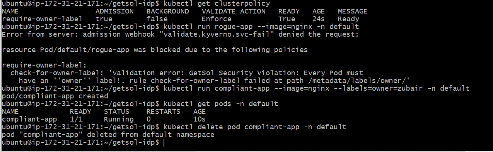

# GetSol Internal Developer Platform (IDP)

An enterprise-grade, GitOps-driven **Internal Developer Platform (IDP)** designed to eliminate developer ticket friction, enforce shift-left security governance, and provide zero-YAML self-service cloud infrastructure provisioning on Amazon Web Services (AWS).

---

## 📑 Table of Contents

- [Executive Summary](#-executive-summary)
- [System Architecture](#-system-architecture)
- [Platform Pillars & Core Capabilities](#-platform-pillars--core-capabilities)
- [Visual Tour & Production Proof](#-visual-tour--production-proof)
- [Repository Structure](#-repository-structure)
- [Deployment & Replication Guide](#-deployment--replication-guide)
- [Security & Governance (Policy-as-Code)](#-security--governance-policy-as-code)
- [Day-2 Operations & Lifecycle Management](#-day-2-operations--lifecycle-management)
- [Tech Stack](#-tech-stack)

---

## 🚀 Executive Summary

Modern engineering teams often face severe developer bottlenecks:
1. **Infrastructure Tickets:** Developers wait days for operations teams to provision cloud storage, databases, and IAM permissions.
2. **Configuration Overload:** Developers are forced to master complex AWS APIs, Terraform syntax, and verbose Kubernetes manifests.
3. **Security Drift:** Un-governed cloud deployments lead to un-tagged, orphaned, or un-encrypted infrastructure with no clear audit trail.

The **GetSol IDP** solves this through a unified control plane built on **Kubernetes (K3s)**. By integrating **Spotify Backstage / GetSol Self-Service Portal**, **Argo CD**, **Crossplane**, and **Kyverno**, developers can provision production-ready cloud storage and deploy containerized services via an intuitive web interface with zero CLI or YAML requirements—while compliance policies are enforced automatically before resources ever reach AWS.

---

## 🏛 System Architecture

The platform establishes a closed-loop GitOps reconciliation engine between developer requests, policy admission controls, and live cloud providers:

<pre><code>
                               [ Developer ]
                                     │
                 ┌───────────────────┴───────────────────┐
                 │ Interacts via Web UI (Zero YAML)      │
                 ▼                                       ▼
    ┌─────────────────────────────┐         ┌─────────────────────────────┐
    │  GetSol Developer Portal    │         │      Backstage Catalog      │
    │  (Port 30080)               │         │      (Port 30070)           │
    │  - On-Demand S3 Provisioning│         │      - Service Registry     │
    │  - Live Inventory Tracking  │         │      - Systems & Domains    │
    └──────────────┬──────────────┘         └──────────────┬──────────────┘
                   │                                       │
                   ▼ (Submits Declarative Intent)          │
    ┌──────────────────────────────────────────────────────┴──────────────┐
    │                    KUBERNETES CONTROL PLANE                         │
    │                                                                     │
    │  ┌───────────────────────────────────────────────────────────────┐  │
    │  │ 🛡️  KYVERNO ADMISSION CONTROLLER (Policy-as-Code)            │  │
    │  │     - Intercepts API requests at the admission webhook        │  │
    │  │     - Validates mandatory 'owner' and governance labels       │  │
    │  │     - Enforces immediate rejection on violations              │  │
    │  └───────────────────────────────┬───────────────────────────────┘  │
    │                                  │ Approved                          │
    │                                  ▼                                  │
    │  ┌───────────────────────────────────────────────────────────────┐  │
    │  │ 🔄  ARGO CD GITOPS ENGINE (App-of-Apps Pattern)               │  │
    │  │     - Continuously reconciles cluster state against Git       │  │
    │  │     - Automated self-healing and drift mitigation             │  │
    │  └───────────────────────────────┬───────────────────────────────┘  │
    │                                  │ Synchronized                     │
    │                                  ▼                                  │
    │  ┌───────────────────────────────────────────────────────────────┐  │
    │  │ ☁️   CROSSPLANE CLOUD CONTROLLER (AWS S3 Provider)             │  │
    │  │     - Manages cloud infrastructure via custom resources       │  │
    │  │     - Securely consumes AWS IAM secrets in-cluster            │  │
    │  └───────────────────────────────┬───────────────────────────────┘  │
    │                                  │                                  │
    │  ┌───────────────────────────────┴───────────────────────────────┐  │
    │  │ 📦  DEVELOPER WORKLOAD RUNTIME                                │  │
    │  │     - getsol-backend-api (2 Replicas, NodePort 30090)         │  │
    │  │     - Injected with dynamic S3 bucket environment variables   │  │
    │  └───────────────────────────────────────────────────────────────┘  │
    └──────────────────────────────────┬──────────────────────────────────┘
                                       │ AWS API (us-east-1)
                                       ▼
    ┌─────────────────────────────────────────────────────────────────────┐
    │                     AMAZON WEB SERVICES (AWS)                       │
    │                                                                     │
    │   🪣 Live S3 Buckets Provisioned on Demand:                         │
    │      - getsol-android-app-photos-4379 (via Self-Service Portal)     │
    │      - getsol-idp-bucket-zubair-1791891872 (via GitOps Manifest)   │
    └─────────────────────────────────────────────────────────────────────┘
</code></pre>

---

## ⚡ Platform Pillars & Core Capabilities

### 1. Developer Self-Service Portal (`:30080`)
- **Zero-Friction DevEx:** Developers fill out three basic fields (Bucket Name, Owner Team, AWS Region) and click **"Provision Storage on AWS"**.
- **Real-Time Fleet Inventory:** Features a live dashboard that queries the Kubernetes API and displays Crossplane health indicators (`Ready in AWS`, `Provisioning`, or `Synced`) with 5-second automatic polling.
- **Self-Service Decommissioning:** Developers can decommission their own ephemeral test resources directly from the UI, preventing cloud cost bloat.

### 2. GitOps Continuous Delivery (Argo CD)
- **App-of-Apps Bootstrap:** Utilizes an orchestrating `root-platform` application watching the `platform/` directory.
- **Automated Drift Correction:** Built with `selfHeal: true` and `prune: true` to prevent unauthorized manual mutations directly on the cluster.
- **Modular Packaging:** Deploys Helm-based vendor charts (Kyverno, Crossplane, Backstage) alongside raw declarative application manifests.

### 3. Cloud Native Infrastructure as Code (Crossplane)
- **Kubernetes as the Cloud Control Plane:** Eliminates brittle client-side Terraform executions by managing AWS resources as native Kubernetes Custom Resources (`Bucket.s3.aws.upbound.io`).
- **Granular Security:** AWS credentials are encrypted inside a namespace-isolated Kubernetes secret (`aws-creds`) and linked to a cluster-scoped `ProviderConfig`.

### 4. Policy-as-Code & Shift-Left Guardrails (Kyverno)
- **Deterministic Admission Control:** Uses an `Enforce` validation action to validate that every workload contains verifiable metadata (e.g., `owner: ?*`).
- **Instant Developer Feedback:** Rejects non-compliant deployment requests at the API boundary with actionable human-readable violation messages.

### 5. High-Availability Application Runtime
- **Dual-Replica Microservices:** Demonstrates real workload hosting via `getsol-backend-api`, featuring automated internal load balancing and zero-downtime rolling upgrades.
- **Configuration Injection:** Seamlessly binds provisioned AWS storage bucket identifiers into the microservice runtime environment.

---

## 📸 Visual Tour & Production Proof

### 1. The GetSol Self-Service Developer Portal
The developer-facing web application allows engineers to provision AWS infrastructure without writing code or interacting with cloud consoles.

### 2. AWS Management Console S3 Verification
Verification showing live S3 storage buckets created in AWS `us-east-1` directly triggered by the platform's control plane.

### 3. Argo CD GitOps Dashboard
The Argo CD control plane maintaining 100% synchronization and healthy states across all platform modules (`backstage`, `crossplane`, `kyverno`, and `root-platform`).

### 4. Kyverno Policy Guardrail in Action
Real-time demonstration of Kyverno blocking an un-governed pod (`rogue-app`) due to missing ownership labels, followed by successful admission of `compliant-app`.

### 5. Live Developer Backend Microservice
The live containerized application running in high availability across multiple pods, reachable externally via NodePort.

---

## 📂 Repository Structure

<pre><code>
getsol-idp/
├── platform/
│   ├── root-app.yaml                 # ArgoCD Root Application (App-of-Apps)
│   ├── kyverno.yaml                  # Kyverno Helm Application definition
│   ├── crossplane.yaml               # Crossplane Core Application definition
│   ├── provider-aws.yaml             # Crossplane Upbound AWS S3 Provider
│   ├── provider-config.yaml          # AWS Provider credential linkage
│   ├── s3-storage.yaml               # Baseline platform storage declaration
│   ├── policy-require-owner.yaml     # Kyverno ClusterPolicy guardrail
│   ├── backstage.yaml                # Spotify Backstage Portal deployment
│   ├── portal.yaml                   # GetSol Self-Service Web Portal (App, SA, RBAC)
│   └── developer-app.yaml            # Sample developer backend microservice
└── README.md                         # Platform documentation
</code></pre>

---

## 🛠 Deployment & Replication Guide

### Prerequisites
- An AWS EC2 instance (Ubuntu 22.04 LTS, recommended: `t3.medium` or larger with 40 GiB `gp3` disk).
- AWS Inbound Security Group allowing ports:
  - `22` (SSH)
  - `30472` (Argo CD Dashboard)
  - `30070` (Backstage Catalog)
  - `30080` (GetSol Developer Portal)
  - `30090` (Developer Microservice API)
- An AWS IAM user with `AmazonS3FullAccess` permissions and generated Access Keys.

### 1. Initialize the Kubernetes Runtime (K3s)
Run on your EC2 instance:
<pre><code>curl -sfL https://get.k3s.io | sh -
sudo chmod 644 /etc/rancher/k3s/k3s.yaml
sudo mkdir -p /etc/rancher/k3s
echo 'write-kubeconfig-mode: "0644"' | sudo tee -a /etc/rancher/k3s/config.yaml
</code></pre>

### 2. Install Argo CD & Expose via NodePort
<pre><code>kubectl create namespace argocd
kubectl apply -n argocd -f https://raw.githubusercontent.com/argoproj/argo-cd/stable/manifests/install.yaml
kubectl patch svc argocd-server -n argocd -p '{"spec": {"type": "NodePort", "ports": [{"port": 443, "nodePort": 30472}]}}'
</code></pre>

Retrieve initial admin password:
<pre><code>kubectl -n argocd get secret argocd-initial-admin-secret -o jsonpath="{.data.password}" | base64 -d; echo
</code></pre>

### 3. Bootstrap the GitOps Root Application
Clone this repository and apply the root application manifest:
<pre><code>cd ~
git clone https://github.com/Muhammad-Zubair796/getsol-idp.git
cd getsol-idp
kubectl apply -f platform/root-app.yaml
</code></pre>

### 4. Inject AWS Cloud Credentials
Securely inject AWS credentials into the cluster for Crossplane consumption:
<pre><code>cat &lt;&lt;EOF &gt; aws-creds.ini
[default]
aws_access_key_id = &lt;YOUR_AWS_ACCESS_KEY_ID&gt;
aws_secret_access_key = &lt;YOUR_AWS_SECRET_ACCESS_KEY&gt;
EOF

kubectl create secret generic aws-creds -n crossplane-system --from-file=creds=./aws-creds.ini
rm aws-creds.ini
</code></pre>

### 5. Access the Platform Endpoints
| Interface | URL | Credentials / Notes |
| :--- | :--- | :--- |
| **Argo CD Dashboard** | `https://<EC2_PUBLIC_IP>:30472` | User: `admin`, Password from Step 2 |
| **GetSol Developer Portal** | `http://<EC2_PUBLIC_IP>:30080` | Zero-auth developer self-service |
| **Backstage Software Catalog** | `http://<EC2_PUBLIC_IP>:30070/catalog` | Component and systems catalog |
| **Developer Backend API** | `http://<EC2_PUBLIC_IP>:30090` | Load-balanced microservice |

---

## 🔒 Security & Governance (Policy-as-Code)

To prevent cluster degradation and resource misattribution, Kyverno evaluates all inbound API requests against declarative governance rules before persistence.

### Enforced ClusterPolicy (`require-owner-label`)
<pre><code>apiVersion: kyverno.io/v1
kind: ClusterPolicy
metadata:
  name: require-owner-label
spec:
  validationFailureAction: Enforce
  background: false
  rules:
  - name: check-for-owner-label
    match:
      any:
      - resources:
          kinds:
          - Pod
          namespaces:
          - default
    validate:
      message: "GetSol Security Violation: Every Pod must have an 'owner' label!"
      pattern:
        metadata:
          labels:
            owner: "?*"
</code></pre>

### Verification Test
1. **Rogue Submission (Non-Compliant):**
<pre><code>kubectl run rogue-app --image=nginx -n default
# Result: Denied by admission webhook validate.kyverno.svc-fail
</code></pre>

2. **Compliant Submission:**
<pre><code>kubectl run compliant-app --image=nginx --labels=owner=team-zubair -n default
# Result: Created successfully
</code></pre>

---

## 🔄 Day-2 Operations & Lifecycle Management

### Pausing the Platform (Zero Compute Cost)
When not actively in use, the entire platform can be parked without losing state:
1. Navigate to **AWS Console -> EC2 -> Instances**.
2. Select `idp-platform-server` and choose **Instance state -> Stop instance** (Do **NOT** terminate).
3. Compute charges immediately drop to **$0.00**. State is preserved on the EBS volume.

### Resuming the Platform
1. In AWS Console, select **Instance state -> Start instance**.
2. Copy the new public IP address assigned by AWS.
3. Update endpoints to the new IP address—all services, storage volumes, and GitOps state automatically recover.

---

## 🧰 Tech Stack

| Layer | Technology | Version | Purpose |
| :--- | :--- | :--- | :--- |
| **Infrastructure** | Amazon Web Services (AWS) | EC2 / S3 | Cloud compute and object storage |
| **Host OS** | Ubuntu Linux | 22.04 LTS | Base server environment |
| **Container Engine** | Rancher K3s | v1.36.5 | Lightweight certified Kubernetes distribution |
| **GitOps Continuous Delivery** | Argo CD | v3.5.5 | Declarative continuous deployment & self-healing |
| **Policy-as-Code** | Kyverno | v3.2.6 | Kubernetes-native admission controller |
| **Cloud Control Plane** | Crossplane | v1.15.0 | Multi-cloud control plane engine |
| **AWS Provider** | Upbound AWS S3 Provider | v1.16.0 | Declarative AWS S3 management CRDs |
| **Developer Portal** | Spotify Backstage & GetSol Portal | v2.10.2 / Custom | Self-service software templates and cloud UI |

---

## 👤 Author & Maintainer

**Muhammad Zubair**  
- **GitHub:** [@Muhammad-Zubair796](https://github.com/Muhammad-Zubair796)  
- **Project:** GetSol Internal Developer Platform (IDP)  

*Engineered with precision for modern cloud native developer velocity.*
